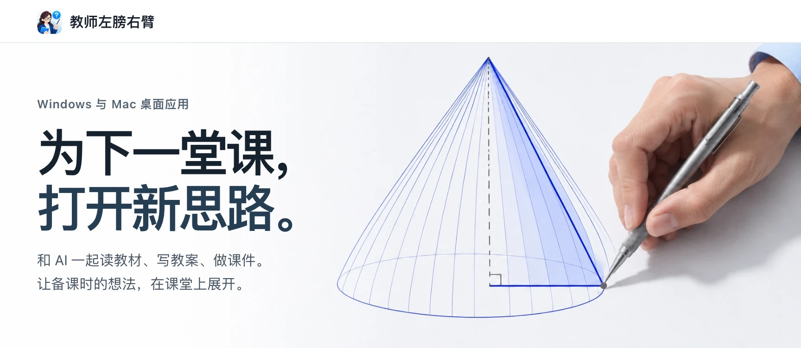

<a href="https://ai-frontier-classrep.github.io/teacher-workbench/">
  <picture>
    <source media="(max-width: 767px)" srcset="assets/hero-mobile.webp">
    
  </picture>
</a>

  
  

[打开完整展示页 ↗](https://ai-frontier-classrep.github.io/teacher-workbench/) · [产品官网](https://accounts.iris-pro.com.cn/) · [安装说明](https://accounts.iris-pro.com.cn/pages/help.html#installation)

<h2> 关注 AI 前沿课代表</h2>

新模型、新工具怎么用在教学里？来小红书看实战拆解。

[**去小红书关注 ↗**](https://xhslink.com/m/79b0CqDhBij)

**小红书号**　<code>63633132548</code>

用小红书扫码，或搜索上方号码，进入主页点「关注」。[查看完整名片](https://ai-frontier-classrep.github.io/teacher-workbench/assets/xiaohongshu-profile-card.jpg)

 

### 走进教学工作台。

课前备课、教学设计、教学课件、教学配图、互动实验。选一个场景，看看从哪里开始、能带走怎样的课堂材料。

<a href="https://ai-frontier-classrep.github.io/teacher-workbench/#studio">
  <picture>
    <source media="(max-width: 767px)" srcset="assets/studio-mobile.webp">
    
  </picture>
</a>

[看五个场景的实机演示 ↗](https://ai-frontier-classrep.github.io/teacher-workbench/#studio) · [查看完整功能说明](https://accounts.iris-pro.com.cn/pages/product.html)

### 下载与安装

| 系统 | 安装包 | GitHub 备用下载 | 校验 |
| --- | --- | --- | --- |
| Windows 10 / 11，x64 | EXE · 319.7 MiB | [Windows 2.2.9.20261102.5](https://github.com/AI-Frontier-ClassRep/teacher-workbench/releases/latest) | [SHA-256](SHA256.txt) |
| Apple M 系列芯片，建议 macOS 15 或更新版本 | DMG · 约 286 MiB | [Mac 2.2.9 测试版](https://github.com/AI-Frontier-ClassRep/teacher-workbench/releases/tag/v2.2.9-macos-arm64-test.20261119) | [SHA-256](https://download.iris-pro.com.cn/downloads/SHA256-macos.txt) |

Windows 用户运行安装程序即可。Mac 用户打开 DMG 后，将应用拖入「应用程序」。Mac 测试版使用本地签名，尚未经过 Apple 公证。[查看安装说明](https://accounts.iris-pro.com.cn/pages/help.html#installation)

### 第一次使用

用手机号注册可免费体验 30 天。在设置中填入自己的模型 API，选择工作区，就可以开始备课。模型 API 和生图调用费用另计。[使用帮助](https://accounts.iris-pro.com.cn/pages/help.html) · [会员与费用](https://accounts.iris-pro.com.cn/pages/membership.html)

**AI 前沿课代表** 出品 · [第三方许可说明](THIRD-PARTY.md)
